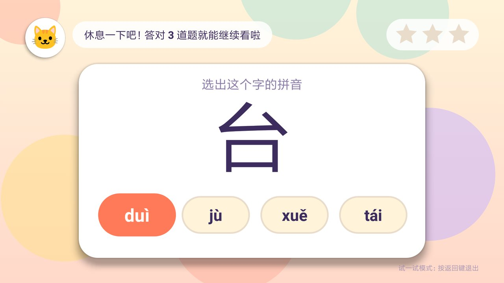
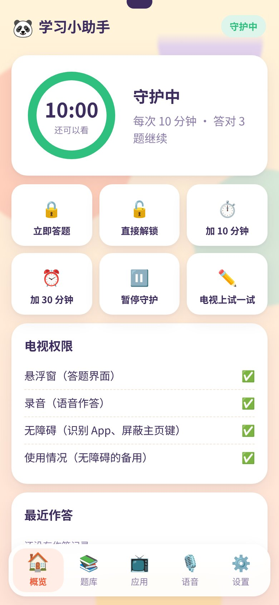
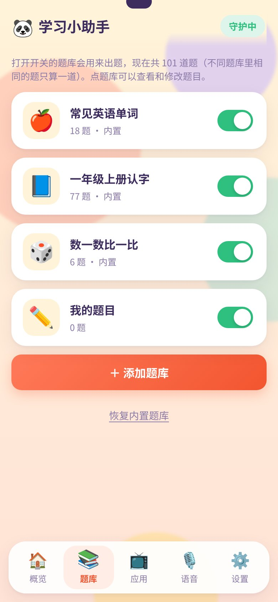
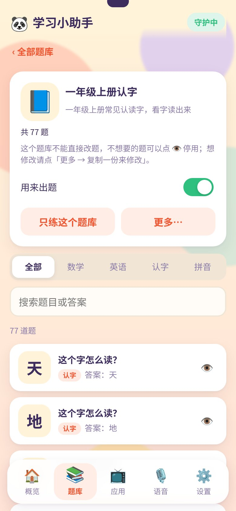
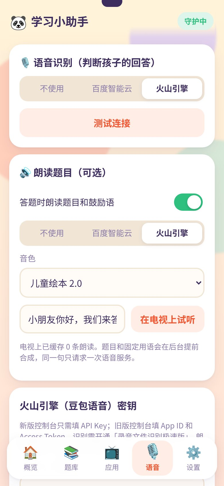

# 学习小助手 / TV Study Helper

[](https://github.com/huhengbo/tv-study-helper/actions/workflows/ci.yml)
[](https://github.com/huhengbo/tv-study-helper/actions/workflows/release.yml)

小米电视上的儿童观看时间守护：看够设定的时间后自动暂停播放、弹出答题，答对指定数量的题目才能继续看。
家长用手机浏览器扫电视上的二维码管理题库和设置，不需要单独安装手机 App。

> [!IMPORTANT]
> **目前只在小米电视 4A（Android 6.0.1，MIUI TV）上验证过。** 语音键识别、让小爱同学让出麦克风、系统浮层层级等都依赖小米电视的系统行为，其他小米型号大概率可用但未测试，其他品牌的电视可能需要适配。欢迎在 Issue 里反馈你的电视型号和测试结果。

## 功能

- **计时**：每次可看 N 分钟；可只统计指定 App（如少儿视频）的观看时间，到点前右上角提醒。
- **科目**：数学（自动出加减法或自定义）、英语（看图说单词）、认字（看字读出来）、拼音（看字选拼音，可从认字题库自动生成）。
- **作答方式**：语音回答（按住遥控器语音键说话）或选择题（方向键选）。任何科目的题都可以设为任一作答方式。
- **语音识别**：离线（电视本机，下载约 48MB 的离线语音包后不联网、不用密钥）或在线（百度智能云 / 火山引擎）。在线识别出错或没网时可自动改用离线识别。
- **题库包**：按书、绘本或单元分组，每个题库一个开关，可「只练这个题库」；多个题库里相同的题只出一次；按题库统计掌握情况。支持自建、导入/导出文件、从分享题库安装和升级。
- **朗读**：可选，用第三方 TTS 读题目和鼓励语，适合还不认字的孩子。合成结果缓存在电视上，同一句话只请求一次。
- **防绕过**：答题界面在系统级浮层上，主页键无效；关机重启、升级后仍保持锁定；开机自动守护。
- **家长**：电视上按菜单键输入 PIN 解锁；手机端可立即答题、解锁、加时、暂停守护、查看作答记录。
- **版本更新**：打开手机管理页时检查新版本，点一下「更新到电视」，电视自动下载并弹出安装界面，遥控器点「安装」即可。

## 截图

电视端（小米电视 4A，1080p）：

| | |
|---|---|
| <br>首页：剩余时间、守护状态，手机扫码管理（二维码已打码） | <br>答题浮层：看字选拼音，方向键选择；语音题按住遥控器语音键回答 |

手机管理页（浏览器打开，不用装 App）：

| 概览 | 题库 | 题库详情 | 语音 |
|---|---|---|---|
|  |  |  |  |
| 剩余时间、立即答题、解锁、加时、暂停 | 每个题库一个开关，相同的题只出一次 | 掌握情况、只练这个题库、单题停用 | 识别与朗读服务、音色、密钥 |

参考了 [kidslock](https://github.com/wplleo/kidslock) 的功能清单（开机自启、定时锁屏、重启仍锁、认字拼音解锁、家长 PIN）。该项目没有开源许可证，本项目未使用其代码。

## 技术栈

| 层 | 技术 |
|---|---|
| 电视端 | Kotlin、Android SDK（minSdk 23，targetSdk 30），无第三方 UI 框架 |
| 手机管理页 | 原生 HTML/CSS/JS，由电视上的 NanoHTTPD 提供（端口 8848） |
| 语音 | 离线识别 [sherpa-onnx](https://github.com/k2-fsa/sherpa-onnx)（中英双语流式 zipformer，边录边识别）；在线识别与合成用百度智能云 / 火山引擎（豆包），按住说话、整段上传 |
| 质量 | JUnit 单元测试、Android Lint、GitHub Actions |

## 架构

```
 手机浏览器 ──扫码──▶ 电视上的管理网页（NanoHTTPD :8848，家长 PIN 换令牌）
                          │
 遥控器语音键 ──▶ 答题浮层（系统级窗口） ◀── 守护服务（计时、锁定、暂停其他 App 播放）
                          │                       ▲
                          ▼                       │ 无障碍服务：识别前台 App
                 录音 16kHz PCM ──▶ 离线（sherpa-onnx，边录边识别）或 百度 / 火山 识别 ──▶ 本地判分（拼音、中文数字、英文归一化）
                 题目文字 ──▶ 百度 / 火山 合成 ──▶ 本地缓存 mp3 ──▶ 朗读

 版本更新：GitHub Release（update.json + APK）──直连或国内镜像──▶ 校验码 + 签名核对 ──▶ 系统安装界面
```

所有数据（设置、题库、作答记录）都保存在电视上，没有云端账号；联网只用于在线语音识别与合成、分享题库、下载离线语音包和版本更新。

## 安装

1. 从 [Releases](https://github.com/huhengbo/tv-study-helper/releases) 下载 `tv-study-helper-x.y.z.apk`（或自己编译，见「开发」），用 U 盘或电视上的文件管理器安装（需允许「安装未知来源应用」）。
2. 电视上打开：设置 → 账号与安全 → ADB 调试，把开关打开。
3. 打开「学习小助手」，会自动进入「开启必要权限」页：点「开始授权」，电视弹出「允许 USB 调试吗？」时用方向键移到「确定」再按确认键。应用会自己开启录音、悬浮窗、使用情况访问权限和无障碍服务（保留系统已有的服务，如小爱同学），不需要电脑。完成后建议把 ADB 调试关掉。

   小米电视的设置里没有悬浮窗、无障碍、使用情况的页面，所以用这种方式授权。电脑上正连着这台电视的 adb 时请先断开，否则电视不会响应应用的连接。以后缺权限时，首页会出现「开启权限」按钮，随时可以重新进入。

   这种方式不可用时（别的机型不支持网络 adb 等），也可以在电脑上装好 [adb](https://developer.android.com/tools/releases/platform-tools)，与电视同一局域网后执行：

   ```bash
   scripts/setup_tv.sh <电视IP> tv-study-helper-x.y.z.apk
   ```

   脚本安装 APK 并完成同样的授权。
4. 电视上打开「学习小助手」，手机扫码进入管理页，默认家长密码 `1234`，请立即修改。
5. 在手机「应用」页勾选要管控的 App；在「语音」页选择识别方式：下载离线语音包用离线识别，或填写百度智能云 / 火山引擎的密钥用在线识别（都不设置也能用选择题作答）。

正式版 APK 的签名证书 SHA-256：

```
25:D1:01:2A:55:F3:2E:5D:7C:1F:2B:59:CA:D2:81:21:7F:44:8C:FE:11:CF:98:AA:1C:CF:83:DE:ED:E6:34:4C
```

可用 `apksigner verify --print-certs xxx.apk` 核对。自己编译的版本签名不同，不能和正式版互相覆盖安装，需要先卸载。

## 版本更新

- 家长打开手机管理页时，电视检查 GitHub Release 上的 `update.json`（`releases/latest/download/update.json`），有新版本就在概览页顶部提示，附带 CHANGELOG 里的更新内容。设置页底部也可以手动「检查更新」。不在电视上弹窗，不打扰孩子。
- 国内直连 GitHub 常常很慢，电视会同时请求 GitHub 和几个国内镜像（`update/UpdateManifest.kt` 的 `UpdateSource.MIRRORS`），谁先返回先用谁，下载失败自动换下一个。
- 下载后依次核对文件大小、SHA-256、包名、版本号和签名证书（必须与电视上已安装的一致），全部通过才拉起系统安装界面，家长用遥控器点「安装」。镜像是第三方服务，被篡改的安装包过不了这几道核对。
- 小米电视 4A 等 Android 7.1 以前的系统不信任 Let's Encrypt 的根证书，而 GitHub 的下载服务器正在使用它；程序自带了 ISRG Root X1 根证书作为补充（`voice/TlsCompat.kt`）。
- 答题锁定中不能更新（系统安装界面会被答题浮层挡住）。升级后守护自动恢复，原来是锁定状态的仍然锁定；设置、题库、作答记录都保留。

## 离线语音识别

- 引擎是 [sherpa-onnx](https://github.com/k2-fsa/sherpa-onnx) v2.0.1，模型是 `sherpa-onnx-streaming-zipformer-small-bilingual-zh-en-2023-02-16` 的 int8 版本（中文按字、英文按 BPE，一个模型同时识别中文、英语单词和数字）。
- 运行库和模型都不打进 APK，家长在手机「语音」页点「下载到电视」时，从本仓库的预发布 [`offline-asr-1`](https://github.com/huhengbo/tv-study-helper/releases/tag/offline-asr-1) 下载约 48MB，和版本更新走同样的镜像。文件清单和 SHA-256 写在 `voice/LocalAsrPack.kt` 里，随签名的 APK 发布，下载的文件逐个核对。
- 预发布里的文件由 `scripts/offline_asr_pack.sh` 生成：从 sherpa-onnx 官方发布下载运行库和模型，只取 int8 文件，由 `bpe.model` 导出热词要用的 `bpe.vocab`，逐个 gzip；可重复生成，结果逐字节一致。
- 识别时把题目答案作为热词（`modified_beam_search`），提高孩子说单字、单词时的命中率；判分仍走本地的拼音、中文数字、英文归一化规则。
- 录音时就把音频送去解码（边录边识别），松开语音键后只需解码结尾一小段。答题开始时提前加载模型，闲置 3 分钟后释放内存。
- 小米电视 4A 实测：加载模型约 6.5 秒（在答题开场白期间完成）；解码约 0.8 倍实时，2 线程最快（4 线程反而慢一倍）；说完后约 0.6 秒出结果；App 内存约 85MB。孩子发音的识别准确率还需要更多实测，可在首页「语音诊断」里录一段后按方向键右核对。

## 结构

```
tv/src/main/java/de/huyc/studyhelper/
├── core/    守护服务（计时、锁定）、无障碍服务、开机启动、暂停其他 App 播放、应用内授权（本机 adb 客户端）
├── quiz/    出题、判分（拼音/中文数字/英文归一化）、答题进度规则
├── voice/   语音键识别、遥控器录音、离线识别（sherpa-onnx）与离线语音包、百度/火山 ASR 与 TTS、朗读缓存、HTTP 与证书兼容
├── update/  检查新版本、镜像选择、下载核对与安装
├── ui/      首页、答题浮层、PIN 面板、主题与动效、表情图片渲染
├── web/     手机管理网页的 HTTP 接口（NanoHTTPD，端口 8848）
└── diag/    语音诊断页（录音与回放、离线识别核对，排查遥控器麦克风）
tv/src/main/java/com/k2fsa/sherpa/onnx/  sherpa-onnx 的 Kotlin 接口（原样摘录，JNI 按类名查找）
tv/src/main/assets/web/    手机管理网页（原生 HTML/CSS/JS）
tv/src/main/assets/packs/  内置题库包（与分享题库同一格式）
tv/src/main/assets/emoji/  Noto 表情图片（Apache 2.0），电视系统字体没有彩色表情
scripts/                   setup_tv.sh 用电脑安装与授权（备用）、check.sh 全部检查、version.sh 版本号与升级清单、offline_asr_pack.sh 生成离线语音包
```

## 题目模型与扩展

题目由两个正交维度描述（`data/Models.kt`）：

| 维度 | 取值 | 决定什么 |
|---|---|---|
| `Subject` 科目 | 数学、英语、认字、拼音 | 语音答案怎么判分（`quiz/AnswerMatcher`）、识别用中文还是英文模型 |
| `AnswerMode` 作答方式 | 语音回答、选择题 | 答题界面用麦克风还是选项（`ui/QuizView`） |

题目来源有两种：题库包和自动出题器（`quiz/Generators.kt`）。组卷时各科目轮流出题，每科的题库题和出题器题混合。

- **新增科目**（如「常识」）：在 `Subject` 加一项，`AnswerMatcher.isCorrect` 的 `when` 会在编译期提示补上判分规则；网页 `app.js` 的 `SUBJECTS` 同步加一项。
- **新增作答方式**（如判断题）：在 `AnswerMode` 加一项，`QuizView.bind` 的 `when` 会提示补上作答区；网页 `MODES` 同步。
- **新增自动出题器**（如「比大小」「看图选单词」）：实现 `QuestionGenerator` 并加入 `Generators.all`，需要开关的话在 `Settings` 里加配置。

## 题库包

题库包是开关和分享的单位，一个包就是一个 JSON 文件（`data/Packs.kt` 的 `PackFormat`）：

```json
{
  "format": "studyhelper-pack",
  "formatVersion": 1,
  "id": "renjiao.yuwen-1a",
  "version": 3,
  "name": "人教版一年级上册·识字",
  "icon": "📘",
  "description": "",
  "author": "",
  "license": "CC-BY-SA-4.0",
  "tags": ["一年级", "语文"],
  "questions": [
    { "id": "u1-1", "subject": "HANZI", "display": "天", "answers": ["天"] },
    { "id": "u1-2", "subject": "ENGLISH", "mode": "CHOICE", "prompt": "苹果的英语是哪一个？",
      "display": "🍎", "answers": ["apple"], "choices": ["apple", "banana", "orange"] }
  ]
}
```

- `id`：小写字母、数字、`.`、`-`、`_`，全局唯一，建议「作者或出处.名称」。`version` 为整数，内容更新时加 1，电视上会提示升级。
- 题目：`mode` 默认 `VOICE`，`prompt` 默认用科目的默认题目文字，`speak` 可选。选择题的 `choices` 要包含正确答案。题目 `id` 在包内唯一且保持稳定，升级时据此保留家长停用的题。
- 兼容：不认识的字段忽略；不认识的科目或作答方式跳过该题（新版本才有的题型不会让老版本出错）。电视上显示不了的表情题导入时跳过。
- 去重：出题时把所有打开的包合在一起，按「科目 + 作答方式 + 展示内容 + 正确答案」去重；作答统计也按此归到每个包。
- 精灵图（可选）：包头 `sheets` 登记图片，题目用 `sprite` 引用其中一格或一组循环播放的帧。`display` 仍必填，是图没下载、损坏时的备用画面（要是电视能显示的表情或文字）。
  ```json
  "sheets": { "s1": { "url": "../sheets/yakka-dee-s1.webp", "cols": 5, "rows": 4, "bytes": 180000, "sha256": "…可选…" } },
  "questions": [
    { "id": "en-banana", "subject": "ENGLISH", "display": "🍌", "answers": ["banana"], "sprite": { "sheet": "s1", "cell": 0 } },
    { "id": "en-dog", "subject": "ENGLISH", "display": "🐶", "answers": ["dog"], "sprite": { "sheet": "s1", "cell": 1, "frames": 4, "fps": 6 } }
  ]
  ```
  - 图宽高分别除以 `cols`、`rows` 得到每格大小；`cell` 从 0 开始、从左到右从上到下数；`frames` 默认 1，大于 1 时从 `cell` 起连续取帧循环播放（最多 64 帧，可跨行），`fps` 默认 6（1~15）。`cols`、`rows` 最大 16，单张图最大 2MB，宽高不超过 2048，建议用 WebP。
  - `url` 只接受 https。分享题库里可以写相对包文件的路径（`packs/x.json` 引用 `../sheets/a.webp`）；文件导入的包没有来源地址，必须写绝对地址。`sha256` 填了就校验下载内容。
  - 引用不存在的图、`cell` 越界、帧数不对的题不会被丢掉，只是去掉 `sprite` 用 `display` 出题，手机端安装时会提示。
  - 图在装包后由电视后台下载，进入答题时对没下好的再试一次；没下好、解码失败或离线没缓存时一律显示 `display`，不影响作答。缓存按「地址 + sha256」存，升级后不再使用的旧图在新图下好后清理，删除题库时一并清理。
  - 去重键不含 `sprite`；多个包里内容相同的题，优先保留带精灵图的。网页编辑自建题库的题时会保留已有的 `sprite`，但网页不能添加或修改精灵图。
- 来源：内置（`assets/packs/`，随程序升级）、分享题库、文件导入只读，可停用单题或「复制一份」再改；家长自建的可以改。
- 许可：建议分享的题库使用 [CC BY-SA 4.0](https://creativecommons.org/licenses/by-sa/4.0/deed.zh-hans)，写在 `license` 字段里。不要上传受版权保护的教材原文。

分享题库目录 `index.json`：`{"format": "studyhelper-index", "packs": [{"id", "name", "icon", "version", "description", "count", "tags", "url"}]}`，`url` 可为相对路径。默认连接公共题库仓库 [study-helper-packs](https://github.com/huhengbo/study-helper-packs)，地址在 `data/PackIndex.kt` 的 `DEFAULT_URL`，手机「设置」页也可改。

从旧版本升级时，原来的 `questions.json` 拆成内置包和「我的题目」，原文件改名为 `questions.legacy.json` 保留。

## 小米电视 4A（Android 6.0.1）上的实测结论

- 语音键：内核上报 `KEY_F5`（scanCode 63），应用层是 `KEYCODE_UNKNOWN`，前台窗口能收到按下/松开。
- 按语音键时系统蓝牙服务会拉起小爱同学。答题界面放在高于小爱浮窗的系统浮层（`TYPE_SYSTEM_ERROR`）上，焦点不会被抢走。
- 遥控器麦克风走标准 `AudioRecord(VOICE_RECOGNITION, 16kHz, 单声道)`；小米的录音策略是先开始录音者占用麦克风。
- 麦克风 HAL 只有一条共享数据通道，小爱同时打开录音会分走约一半音频。程序在开始录音后向小爱发送 `com.xiaomi.mitv.voice.KEYUP` 让其退出录音。**这一步待实测确认**（可在首页「语音诊断」里按住语音键录音、按确认键回放）。
- 系统「动画程序时长缩放」出厂为 0，程序在本进程内恢复为 1，不改系统设置。
- 系统不信任 Let's Encrypt 根证书（见「版本更新」）。

## 开发

需要 JDK 17 和 Android SDK（compileSdk 35）。

```bash
scripts/check.sh                  # 全部检查：版本号、单元测试、lint、release 打包
./gradlew :tv:testDebugUnitTest   # 只跑单元测试
./gradlew :tv:assembleRelease     # 产物 tv/build/outputs/apk/release/tv-release.apk
scripts/setup_tv.sh <电视IP>      # 安装到电视并授权（默认用上面的产物）
```

release 签名读取仓库根目录的 `secrets/android/key.properties`（不进版本库），格式：

```properties
# storeFile 相对 key.properties 所在目录
storeFile=release.jks
storePassword=…
keyAlias=…
keyPassword=…
```

没有这个文件时用 debug 签名，能安装，但不能覆盖安装 release 签名的版本。CI 发布用仓库 Secrets（`ANDROID_KEYSTORE_BASE64`、`ANDROID_STORE_PASSWORD`、`ANDROID_KEY_ALIAS`、`ANDROID_KEY_PASSWORD`）提供同一把密钥。**维护者请备份好 `release.jks` 和密码**：丢失后已安装的用户无法在线升级，只能卸载重装。

## 发布流程

项目使用 [SemVer](https://semver.org/lang/zh-CN/)。当前版本保存在根目录 `VERSION`，Gradle 从这里读取 versionName，versionCode = x×10000 + y×100 + z（升级覆盖安装要求它单调递增）。

1. 日常变更记在 [CHANGELOG.md](CHANGELOG.md) 的 `[Unreleased]` 下。
2. 发版时把它改成 `## [x.y.z] - 日期`，同步更新 `VERSION`。
3. 提交后推送 `vX.Y.Z` tag：流水线校验 tag、`VERSION` 和 CHANGELOG 一致，构建并签名 APK，用 CHANGELOG 对应章节创建 GitHub Release，同时上传 APK、`.sha256` 和升级清单 `update.json`（`scripts/version.sh manifest` 生成），电视据此检查更新。
4. 推送到 `main` 只跑 CI，不发布。

## 已知限制

- 只在小米电视 4A 上验证过，见开头说明。
- 在线语音识别需要家长自己申请百度或火山的密钥；离线识别不需要，但准确率比在线服务低，孩子发音不清时更容易听错。
- 首次安装需要在电视上打开「ADB 调试」，应用通过本机 adb 给自己授权；只在小米电视 4A 上验证过，不支持网络 adb 的机型需要用电脑运行 `scripts/setup_tv.sh`。
- 系统没有 root 权限，更新时需要家长在电视上点一下「安装」，无法静默升级。

## 参与贡献

欢迎 Issue 和 PR，开发约定见 [CONTRIBUTING.md](CONTRIBUTING.md)，行为准则见 [CODE_OF_CONDUCT.md](CODE_OF_CONDUCT.md)，安全问题请按 [SECURITY.md](SECURITY.md) 私下报告。

## 许可证

- 代码：[Apache License 2.0](LICENSE)。
- 内置题库（`tv/src/main/assets/packs/`）：[CC BY-SA 4.0](https://creativecommons.org/licenses/by-sa/4.0/deed.zh-hans)。
- 表情图片（`tv/src/main/assets/emoji/`）来自 [Noto Emoji](https://github.com/googlefonts/noto-emoji)，Apache License 2.0。
- 离线语音包（单独下载，不在 APK 里）：[sherpa-onnx](https://github.com/k2-fsa/sherpa-onnx)（Apache-2.0，静态链接 [ONNX Runtime](https://github.com/microsoft/onnxruntime)，MIT），模型来自 k2-fsa/icefall（Apache-2.0）。`tv/src/main/java/com/k2fsa/sherpa/onnx/` 摘自 sherpa-onnx，Apache-2.0。
- 依赖：[NanoHTTPD](https://github.com/NanoHttpd/nanohttpd)（BSD-3-Clause）、[ZXing](https://github.com/zxing/zxing)（Apache-2.0）、[pinyin4j](https://github.com/belerweb/pinyin4j)（BSD）、AndroidX（Apache-2.0）。
